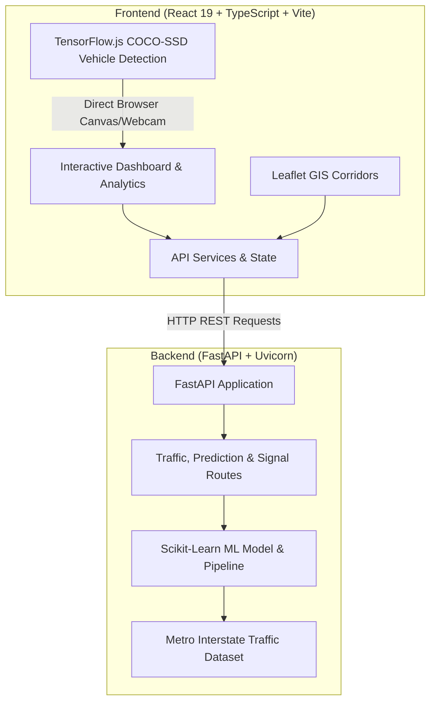

<div align="center">

# 🚦 Road Metric (FlowWatch)

**Intelligent Urban Traffic Monitoring, Computer Vision Vehicle Detection & Adaptive Signal Advisory System**

[](https://fastapi.tiangolo.com)
[](https://react.dev/)
[](https://www.typescriptlang.org/)
[](https://vitejs.dev/)
[](https://www.tensorflow.org/js)
[](https://leafletjs.com/)
[](https://scikit-learn.org/)
[](LICENSE)

</div>

---

## 📌 Table of Contents

- [Overview](#-overview)
- [Key Features](#-key-features)
- [System Architecture](#-system-architecture)
- [Tech Stack](#-tech-stack)
- [Directory Structure](#-directory-structure)
- [Getting Started](#-getting-started)
  - [Prerequisites](#prerequisites)
  - [Backend Setup](#backend-setup)
  - [Frontend Setup](#frontend-setup)
- [API Endpoints](#-api-endpoints)
- [Machine Learning & Computer Vision](#-machine-learning--computer-vision)
- [Testing & Quality](#-testing--quality)
- [License](#-license)

---

## 📖 Overview

**Road Metric** (FlowWatch) is an end-to-end intelligent transportation and traffic management platform. It combines real-time corridor telemetry, interactive GIS spatial maps, client-side computer vision vehicle tracking, machine learning volume forecasting, and adaptive traffic signal advisory algorithms.

Designed specifically with modern urban junctions in mind (such as high-density corridors like Ameerpet, Jubilee Hills, Madhapur, and HITEC City), Road Metric empowers traffic authorities and urban planners to monitor bottlenecks, predict surges before they happen, and optimize signal timings.

---

## ✨ Key Features

- 🏎️ **Live Corridor Monitoring & Telemetry**:
  - Continuous telemetry across arterial segments: velocity (km/h), volume (veh/hr), queue lengths, and congestion status (**Low**, **Moderate**, **High**).
  - Summary metrics and anomaly alerts for proactive incident response.

- 🗺️ **Interactive GIS Map (Leaflet)**:
  - Geospatial mapping with color-coded status markers, interactive tooltips, and segment diagnostic popups.

- 📊 **Deep Analytics & Performance Visualizations**:
  - Interactive charts powered by Recharts comparing corridor speeds, throughput distributions, and peak flow patterns.

- 🤖 **ML-Powered Traffic Volume Prediction**:
  - Random Forest regression pipeline predicting vehicular flow based on calendar factors, time of day, weather classification, temperature, and precipitation.

- 📹 **Edge Computer Vision with TensorFlow.js (COCO-SSD)**:
  - 100% in-browser, privacy-preserving video analysis without requiring server-side GPU streaming.
  - Detects, classifies (**cars, trucks, buses, motorcycles**), and tracks vehicles in traffic videos while computing real-time flow rates (veh/min).

- ⏱️ **Adaptive Signal Timing Advisory**:
  - Dynamic Webster-inspired signal split calculator generating optimal green times and cycle lengths based on approach demand and queue saturation.

---

## 🏗️ System Architecture



---

## 💻 Tech Stack

### Frontend
- **Framework**: React 19 + TypeScript + Vite
- **Styling**: Modern responsive CSS with custom dark/light theme tokens
- **GIS Mapping**: Leaflet & React-Leaflet
- **Data Visualization**: Recharts
- **Edge AI / CV**: TensorFlow.js Core, WebGL backend, `@tensorflow-models/coco-ssd`
- **Icons**: Lucide React
- **Linter**: Oxlint

### Backend
- **Framework**: FastAPI + Uvicorn
- **Data Validation**: Pydantic v2
- **Machine Learning**: Scikit-Learn (RandomForestRegressor, ColumnTransformer, Pipelines)
- **Data Processing**: Pandas, NumPy
- **Model Serialization**: Joblib
- **Testing**: Pytest, HTTPX

---

## 📂 Directory Structure

```text
road-metric/
├── backend/
│   ├── app/
│   │   ├── __init__.py
│   │   └── main.py              # FastAPI endpoints and route handlers
│   ├── ml/
│   │   ├── __init__.py
│   │   └── training.py          # ML data pipeline, training & inference logic
│   ├── scripts/
│   │   └── check_dataset.py     # Dataset validation utility
│   ├── tests/
│   │   ├── test_health.py       # API health check tests
│   │   ├── test_ml_pipeline.py  # ML feature prep & evaluation tests
│   │   └── test_prediction_api.py # Prediction endpoint tests
│   └── requirements.txt         # Python dependencies
├── frontend/
│   ├── public/                  # Static assets & sample traffic video
│   ├── src/
│   │   ├── assets/              # SVG icons & branding
│   │   ├── AnalyticsPage.tsx    # Recharts analytics component
│   │   ├── App.css              # Dashboard styles
│   │   ├── App.tsx              # Main dashboard application
│   │   ├── index.css            # Base stylesheet
│   │   └── main.tsx             # React entrypoint
│   ├── package.json             # Frontend dependencies & scripts
│   ├── tsconfig.json            # TypeScript configuration
│   └── vite.config.ts           # Vite build configuration
├── .gitignore                   # Ignored files (venv, node_modules, cache)
└── README.md                    # Project documentation
```

---

## 🚀 Getting Started

### Prerequisites

Ensure you have the following installed:
- **Node.js**: `v18+` (v20+ recommended)
- **Python**: `3.10+` (3.12 recommended)
- **Git**

---

### Backend Setup

1. **Navigate to the backend directory**:
   ```bash
   cd backend
   ```

2. **Create and activate a virtual environment**:
   - **Windows**:
     ```powershell
     python -m venv .venv
     .\.venv\Scripts\Activate.ps1
     ```
   - **macOS / Linux**:
     ```bash
     python3 -m venv .venv
     source .venv/bin/activate
     ```

3. **Install dependencies**:
   ```bash
   pip install -r requirements.txt
   ```

4. **Start the FastAPI server**:
   ```bash
   uvicorn app.main:app --reload --host 127.0.0.1 --port 8000
   ```
   The backend API will be available at [http://127.0.0.1:8000](http://127.0.0.1:8000).  
   Interactive Swagger docs are accessible at [http://127.0.0.1:8000/docs](http://127.0.0.1:8000/docs).

---

### Frontend Setup

1. **Navigate to the frontend directory**:
   ```bash
   cd frontend
   ```

2. **Install dependencies**:
   ```bash
   npm install
   ```

3. **Start the development server**:
   ```bash
   npm run dev
   ```
   Open [http://localhost:5173](http://localhost:5173) in your browser.

---

## 🔌 API Endpoints

| Method | Endpoint | Description |
|---|---|---|
| `GET` | `/api/health` | Service health status check |
| `GET` | `/api/traffic/summary` | City-wide aggregated traffic metrics, speeds, and alerts |
| `GET` | `/api/traffic/segments` | Segment telemetry (Ameerpet, Jubilee Hills, Madhapur, HITEC City) |
| `GET` | `/api/models/metrics` | Model metadata, training dates, MAE, RMSE, and R² scores |
| `POST` | `/api/predictions/volume` | Predict traffic volume for a custom timestamp and weather conditions |
| `GET` | `/api/signals/recommendations`| Signal phase timings and cycle length advisory recommendations |

### Example Prediction Request:
```bash
curl -X POST "http://127.0.0.1:8000/api/predictions/volume" \
     -H "Content-Type: application/json" \
     -d '{
       "date_time": "2026-10-12T08:30:00",
       "holiday": "False",
       "temp": 298.15,
       "rain_1h": 0.0,
       "snow_1h": 0.0,
       "clouds_all": 20,
       "weather_main": "Clear",
       "weather_description": "clear sky"
     }'
```

---

## 🧠 Machine Learning & Computer Vision

### 1. Traffic Volume Forecasting
- **Dataset**: Metro Interstate Traffic Volume dataset.
- **Model**: Scikit-Learn `RandomForestRegressor` with `ColumnTransformer`.
- **Engineered Features**:
  - Temporal: `hour`, `day_of_week`, `month`, `weekend` boolean.
  - Meteorological: `temp`, `rain_1h`, `snow_1h`, `clouds_all`.
  - Categorical: `holiday`, `weather_main`, `weather_description` (One-Hot Encoded).

### 2. Client-Side Computer Vision
- Built with `@tensorflow-models/coco-ssd` and TensorFlow.js WebGL acceleration.
- Detects multi-class vehicles (`car`, `truck`, `bus`, `motorcycle`).
- Computes vehicle counts, bounding boxes, detection confidences, and flow rates in vehicles per minute directly inside the user's browser.

---

## 🧪 Testing & Quality

Run backend automated tests:
```bash
cd backend
pytest
```

Run frontend linting:
```bash
cd frontend
npm run lint
```

Build frontend for production:
```bash
cd frontend
npm run build
```

---

## 📄 License

This project is licensed under the [MIT License](LICENSE).
